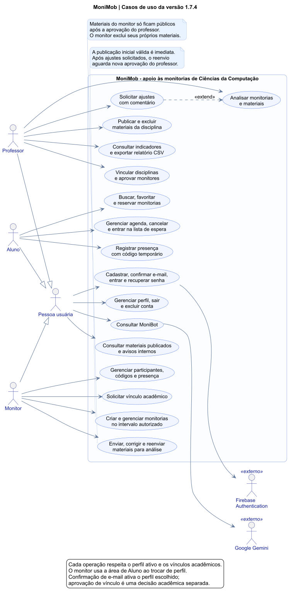

# MoniMob


[](https://github.com/mariomont30/MoniMob/actions/workflows/ci.yml)
[](https://github.com/mariomont30/MoniMob/releases/tag/v1.7.4)
[](LICENSE)

[Português](README.md) · [Documentation index](docs/README.md) ·
[Download Android APK](https://github.com/mariomont30/MoniMob/releases/download/v1.7.4/MoniMob-Android.apk)

## Description

MoniMob connects students, peer tutors and professors through course
assignments, tutoring sessions, reservations, materials and attendance. It is a
Computer Science academic portfolio project developed in the context of the
University of Fortaleza. It is not an official institutional service. The app
interface is in Brazilian Portuguese.

The source illustrates role authorization, transactional reservations,
idempotent commands, versioned academic reviews and a server-side AI
integration.

## Features

| Role         | Main workflows                                                                                                                                                                |
| :----------- | :---------------------------------------------------------------------------------------------------------------------------------------------------------------------------- |
| Student      | Search, filter, save favorites, reserve places, manage an agenda, join waiting lists, open published materials and register attendance using a temporary code.                |
| Peer tutor   | Request a professor assignment, publish sessions within the authorized interval, manage participants and attendance, submit materials, correct and resubmit reviewed content. |
| Professor    | Supervise courses, decide assignment requests, review sessions and materials, request changes, publish materials and export filtered CSV reports.                             |
| All profiles | Use MoniBot, read in-app notices, manage accounts and confirm account deletion.                                                                                               |

Email verification activates the profile selected at registration. Academic
assignment approval is a separate workflow decided by the responsible professor.
Tutor materials require approval; professor materials publish directly.

The 1.7.4 update adds a next-appointment summary, chronological browsing,
related materials, an actionable requested-changes page, demand and occupancy
metrics, privacy filtering and a branded thinking indicator for MoniBot.

### AI integration

The API verifies the user and active role before building a limited, permitted
context. Gemini receives selected records and metadata, not direct database
access. Recent completed conversation turns provide short-term context.

Gemini 3.5 Flash-Lite uses minimal thinking and concise output. A temporary
capacity or network failure may retry through Gemini 3.1 Flash-Lite within the
same bounded provider budget. Account restrictions and quotas do not trigger a
model switch. AI cannot perform academic writes or guarantee correct answers.
The current implementation does not extract full PDF content or use a vector
search pipeline over attachments.

## Technologies

- React Native 0.88, React 19, Expo SDK 58 and JavaScript.
- Firebase Authentication and Cloud Firestore.
- Node.js, Firebase Admin SDK, transactions and scoped database queries.
- Google Gemini through the authenticated backend.
- Expo File System, Sharing, Audio and native date/time selection.
- PlantUML source and rendered use cases, plus GitHub Actions checks.

<details>
<summary>Explore the complete use-case diagram</summary>

[](docs/diagrams/use-cases.svg)

</details>

[Editable PlantUML source](docs/diagrams/use-cases.puml) ·
[Technical guide](docs/ARQUITETURA.md)

## How to Run

Use Node.js 22.13 or later within version 22 and npm. The main local workflow
targets Windows x64 and Android.

```powershell
git clone https://github.com/mariomont30/MoniMob.git
cd MoniMob
Copy-Item backend/.env.example backend/.env
Copy-Item mobile-expo/.env.example mobile-expo/.env
```

Configure your own Firebase web application, enable email/password
authentication, create Firestore, configure an authorized local administrative
credential and set your Gemini key. Follow the
[setup guide](docs/CONFIGURACAO.md). Filled environment files and administrative
credentials are excluded from Git.

```powershell
npm.cmd run iniciar
```

Startup prepares missing dependencies and downloads the official Windows x64
cloudflared binary with a pinned integrity check. It starts the API, HTTPS
tunnel, automatic connection discovery and Expo. Connect the phone and computer
to the same network and scan Expo's current QR code.

The
[released APK](https://github.com/mariomont30/MoniMob/releases/download/v1.7.4/MoniMob-Android.apk)
opens without Expo Go, but online features require the matching backend. This
academic distribution uses the maintainer's Firebase environment and does not
promise an always-online public backend. An independent Firebase environment
needs its own configured mobile build. To start only local API services, use
`npm.cmd run iniciar:apk`.

### Checks

```powershell
npm.cmd run instalar
npm.cmd test
node scripts/check-public.mjs
```

GitHub Actions runs standard checks and isolated Firebase Auth/Firestore
emulator scenarios without real credentials. Tests cover authorization,
concurrency, capacity, waiting lists, attendance, files, reviews and account
deletion. A real Gemini check is optional and consumes provider quota. Tests and
exports do not certify every physical device.

### Current boundaries

The backend and local reminders require an active computer process.
Notifications are in-app messages, not operating-system push alerts. Files use
checksummed Firestore parts up to 5 MB and remain subject to database quotas.
iOS exports are not a substitute for physical-device testing.

Future work includes stable backend hosting, push delivery, broader device
validation, dedicated attachment storage and measured pilot outcomes.

Maintained by [Mário_DEV / @mariomont30](https://github.com/mariomont30) in an
academic collaborative context. See [MIT license](LICENSE),
[contributing](CONTRIBUTING.md), [security](SECURITY.md) and
[third-party notices](THIRD_PARTY_NOTICES.txt). Institutional brands retain
their respective owners' rights.
