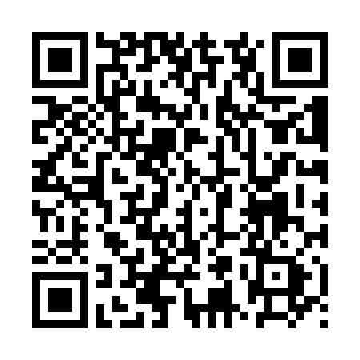

<div align="center">


**Encontre uma monitoria. Reserve seu lugar. Aprenda em comunidade.**

[](https://github.com/mariomont30/MoniMob/releases/download/v1.0.3-qa/MoniMob-Android.apk)


[Baixar para Android](https://github.com/mariomont30/MoniMob/releases/download/v1.0.3-qa/MoniMob-Android.apk) · [Conhecer os recursos](#o-que-você-pode-fazer) · [Executar o projeto](#como-executar) · [Testes](#qualidade-em-prática)

</div>

## Monitoria mais perto de você

O **MoniMob** conecta alunos, monitores e professores em uma experiência para organizar monitorias universitárias. Da busca por uma disciplina à confirmação de presença, cada pessoa encontra as ferramentas da sua área, com acesso autenticado e dados persistidos no Firebase.

Desenvolvido no contexto acadêmico de **Ciências da Computação da Universidade de Fortaleza**, o projeto reúne organização de encontros, acompanhamento de participantes e o **MoniBot**, assistente que utiliza o contexto autorizado da conta para ajudar no uso do aplicativo.

## Baixe, instale e conheça

<table>
<tr>
<td align="center" width="50%">
<a href="https://github.com/mariomont30/MoniMob/releases/download/v1.0.3-qa/MoniMob-Android.apk"></a>
<br /><strong>Aponte a câmera para baixar o APK</strong>
<br /><sub>Android · versão 1.0.3-qa · arquivo hospedado no GitHub Releases</sub>
</td>
<td align="center" width="50%">

</td>
</tr>
</table>

1. [Baixe o APK do MoniMob](https://github.com/mariomont30/MoniMob/releases/download/v1.0.3-qa/MoniMob-Android.apk) no celular Android.
2. Abra o arquivo e autorize a instalação dessa origem, caso o sistema solicite.
3. Abra o aplicativo e cadastre sua conta de aluno ou entre com uma conta autorizada.

> **Conexão desta versão:** o APK usa Firebase e um backend HTTPS temporário. As operações remotas precisam de internet e do servidor de teste ativo no computador responsável. O QR Code baixa o APK diretamente; ele não é um QR Code do Expo Go. Veja o [guia de instalação](docs/instalacao/ANDROID.md).

## O que você pode fazer

| Área | Sua experiência no MoniMob |
|:--|:--|
| 🎓 **Aluno** | Buscar monitorias, aplicar filtros, reservar e cancelar vagas, acompanhar a agenda, favoritar encontros, acessar materiais e confirmar presença. |
| 📚 **Monitor** | Organizar sessões, gerenciar materiais, consultar participantes e acompanhar presença e ausência. |
| 🧭 **Professor** | Supervisionar disciplinas e monitores, avaliar publicações, solicitar ajustes e consultar relatórios com exportação em CSV. |
| 💬 **MoniBot** | Pedir ajuda sobre o aplicativo e suas monitorias, com respostas baseadas nas informações autorizadas da conta. |

**Uma jornada conectada:** busca → reserva → agenda → presença → acompanhamento.

Reservas respeitam capacidade, conflitos e permissões. A fila de espera acompanha a liberação de vagas, e os avisos internos mantêm o aluno informado sobre seus encontros.

## Por dentro do projeto

| Camada | Tecnologias |
|:--|:--|
| Aplicativo | React Native · React · Expo SDK 58 · JavaScript |
| Contas e dados | Firebase Authentication · Cloud Firestore |
| Operações de confiança | Node.js · Firebase Admin SDK · Firebase Cloud Functions |
| Assistente | Gemini, acessado pelo backend |
| Arquivos e dispositivo | Expo FileSystem · Expo Sharing · armazenamento local da sessão |

O aplicativo autentica a conta no Firebase e solicita as operações acadêmicas ao backend. O serviço verifica o perfil e o vínculo antes de consultar ou modificar os dados. A chave privada da IA fica no servidor.

A versão 1.0.3 apresenta a abertura com degradê azul e verde, o símbolo de livro com conversa e um ícone próprio para Android. A mesma identidade aparece na capa deste repositório. A atualização também recupera os filtros avançados e as recomendações, organiza as telas, mantém o histórico do MoniBot e exige confirmação do e-mail para o acesso.

## Como executar

### 1 · Instale as dependências

Use Node.js **22.13 ou superior na linha 22**, versão adotada também pelo backend Firebase, e npm.

```bash
git clone https://github.com/mariomont30/MoniMob.git
cd MoniMob
npm ci --prefix mobile-expo
npm ci --prefix backend
```

### 2 · Configure seu ambiente

Copie `mobile-expo/.env.example` para `mobile-expo/.env` e preencha a configuração pública do seu aplicativo Firebase e o endereço HTTPS do backend.

Copie `backend/.env.example` para `backend/.env` e configure o projeto Firebase, uma credencial autorizada e a chave Gemini. Esses arquivos locais ficam fora do Git.

Os papéis de monitor e professor são vinculados por administração autorizada. O cadastro público cria uma conta de aluno. Consulte o [guia de configuração](docs/CONFIGURACAO.md).

### 3 · Inicie os serviços

```bash
# Terminal 1: backend local
npm run start:backend

# Terminal 2: aplicativo Expo
npm run start:mobile
```

Defina o endereço acessível do backend no ambiente do aplicativo. Para gerar o APK, consulte o [guia Android](docs/instalacao/ANDROID.md).

### 4 · Lembretes locais

```bash
npm --prefix backend run reminders:local
```

A rotina verifica os lembretes de hora em hora enquanto o processo e o computador permanecem ligados. O primeiro ciclo ocorre após uma hora. Os avisos aparecem dentro do MoniMob. O backend também contém a função agendada para ambientes Firebase configurados para essa execução.

## Qualidade em prática

As suítes de testes acompanham o código e podem ser executadas com:

```bash
npm test
```

| Verificação realizada | Resultado registrado |
|:--|:--|
| Testes de código da versão pública | **127 aprovados**, incluindo a configuração pública do Firebase |
| Firebase em ambiente local | **27 verificações aprovadas** |
| Responsividade Android | **320 dp com fonte 200%, paisagem e tablet verificados nesta versão** |
| Arquivo CSV no Android | **6 verificações aprovadas**, com recebimento, abertura e conferência dos dados |
| Lembretes com Firestore real | **3 ciclos automáticos locais**, com persistência e controle de duplicidade |

Também foram exercitados recuperação por e-mail real, permissões dos três perfis, atualização do APK preservando a sessão e uma amostra de navegação com TalkBack. Os resultados descrevem os ambientes executados; a documentação não apresenta uma certificação universal de dispositivos.

Leia o [resumo dos testes executados](docs/testes/RESULTADOS.md). As massas das suítes ficam isoladas em pastas de teste; o aplicativo carrega os dados do Firebase e não cria registros de apresentação automaticamente.

## Um lugar para cada parte

```text
MoniMob/
├── mobile-expo/       Aplicativo, componentes, serviços e testes
├── backend/           API, regras de negócio e lembretes
├── tests/firestore/   Verificações das regras e integração local
├── scripts/           Comandos de execução e verificação da fonte
├── docs/              Guias, identidade visual, QR Code e resultados
└── firestore.rules    Regras de acesso às coleções
```

## Desenvolvimento

Projeto mantido por [**Mário_DEV · @mariomont30**](https://github.com/mariomont30), no contexto da disciplina de Desenvolvimento para Plataformas Móveis.

O texto de apresentação está em português, conforme a versão atual solicitada para o projeto. Os avisos de licença dos componentes utilizados estão preservados em `THIRD_PARTY_NOTICES.txt` e nos respectivos pacotes.

<div align="center">

**MoniMob · Monitoria acadêmica mais simples, próxima e conectada.**

</div>
