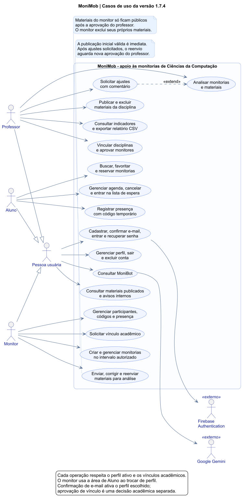

# MoniMob


[](https://github.com/mariomont30/MoniMob/actions/workflows/ci.yml)
[](https://github.com/mariomont30/MoniMob/releases/tag/v1.7.4)
[](https://github.com/mariomont30/MoniMob/releases/download/v1.7.4/MoniMob-Android.apk)
[](LICENSE)

**Explore o projeto:** [Baixar APK](#instalar-no-android) ·
[Executar](#executar-o-código) · [Arquitetura](#decisões-de-engenharia) ·
[Casos de uso](#casos-de-uso) · [Testes](#testes) ·
[Documentação](docs/README.md)

**Idioma:** Português · [English](README.en.md)

## O problema e a proposta

Encontrar uma monitoria, confirmar uma vaga e acompanhar materiais pode envolver
informações espalhadas. O MoniMob reúne essa jornada em um aplicativo para
**Ciências da Computação**, conectando **Aluno, Monitor e Professor**.

O projeto nasceu no contexto acadêmico da Universidade de Fortaleza e é
apresentado aqui como portfólio de engenharia de software. Não é um sistema
institucional oficial. A interface do aplicativo é em português brasileiro.

> **Uma jornada conectada:** vínculo acadêmico → monitoria → reserva →
> presença → acompanhamento, com materiais compartilhados e apoio do MoniBot.

## Três perfis, responsabilidades claras

| Perfil        | O que faz                                                                                                                                                               |
| :------------ | :---------------------------------------------------------------------------------------------------------------------------------------------------------------------- |
| **Aluno**     | Pesquisa e filtra encontros, salva favoritos, reserva vagas, acompanha a agenda, entra na fila de espera, consulta materiais publicados e registra presença por código. |
| **Monitor**   | Solicita vínculo ao professor, publica monitorias no período autorizado, acompanha participantes e presença, envia materiais e corrige itens devolvidos para ajustes.   |
| **Professor** | Supervisiona disciplinas, decide pedidos de vínculo, analisa monitorias e materiais, solicita ajustes com comentário, publica conteúdos e exporta relatórios CSV.       |
| **Todos**     | Usam o MoniBot, recebem avisos internos, gerenciam a própria conta e podem encerrá-la com confirmação de identidade.                                                    |

O perfil escolhido no cadastro é ativado após confirmar o e-mail. A aprovação do
vínculo entre professor, monitor e disciplina é um processo separado, dentro do
aplicativo. O monitor também pode acessar a área de Aluno.

## Instalar no Android

| Baixar para Android | Tela inicial do aplicativo |
| :---: | :---: |
| [](https://github.com/mariomont30/MoniMob/releases/download/v1.7.4/MoniMob-Android.apk) | [](docs/assets/android/monimob-tela-inicial.png) |
| **[Baixar APK · v1.7.4](https://github.com/mariomont30/MoniMob/releases/download/v1.7.4/MoniMob-Android.apk)** | [Ampliar a tela inicial](docs/assets/android/monimob-tela-inicial.png) |

> [!NOTE]
> O APK abre sem Expo Go em **Android 7.0 ou superior**. As funções online
> precisam de internet e do backend ativo. Nesta distribuição acadêmica,
> a disponibilidade depende do ambiente do mantenedor. O aplicativo descobre
> automaticamente o endereço do servidor.

O QR Code leva ao download do instalador. A
[release v1.7.4](https://github.com/mariomont30/MoniMob/releases/tag/v1.7.4)
inclui a soma de verificação SHA-256 do APK.

Para executar uma cópia independente, configure seu próprio Firebase e Gemini
conforme o [guia de configuração](docs/CONFIGURACAO.md). O APK distribuído não
troca de projeto Firebase ao alterar os arquivos locais do clone.

## O que mudou na 1.7.4

### Agenda e descoberta

- **Próxima reserva do aluno** na página inicial, catálogo ordenado por data e
  materiais publicados acessíveis nos detalhes da monitoria.
- **Favoritos** vinculados à conta, com acesso aos encontros e às recomendações.

### Supervisão acadêmica e relatórios

- **Fluxo de vínculo** com validade de data e horário. Toda a duração da monitoria
  precisa caber no intervalo autorizado.
- **Materiais do professor** publicados diretamente; materiais do monitor liberados
  aos alunos somente após aprovação. Alterações geram uma nova revisão.
- **Página Ajustes solicitados**, com disciplina, item, orientação do professor
  e correção com reenvio para análise. A página atualiza os dados ao ser aberta.
- **Indicadores de demanda, fila de espera e ocupação**, além de presença e
  histórico acadêmico no CSV.

### MoniBot e experiência de uso

- **MoniBot** com respostas concisas, contexto autorizado, filtragem adicional de
  dados sensíveis e recuperação limitada em falhas temporárias.
- **Símbolo do aplicativo e pontos animados** durante a consulta à IA. A animação
  termina na resposta ou falha e respeita movimento reduzido.
- **Conta com exclusão confirmada**, retorno à abertura com animação e som conforme
  as preferências do dispositivo e campos com validações e mensagens de erro.

Consulte o [changelog](CHANGELOG.md) para os detalhes desta atualização pública.

## Decisões de engenharia

| Decisão                                 | Motivo e limite                                                                                                                                          |
| :-------------------------------------- | :------------------------------------------------------------------------------------------------------------------------------------------------------- |
| **React Native + Expo SDK 58**          | Componentes compartilhados e desenvolvimento com Expo Go, preservando um projeto Android nativo. A exportação iOS não substitui validação em aparelho.   |
| **Firebase Authentication + Firestore** | Identidade, confirmação de e-mail e persistência. A API verifica o usuário e o perfil antes das operações acadêmicas.                                    |
| **Comandos idempotentes e transações**  | Evitam repetir uma gravação após perda de resposta e protegem capacidade e duplicidade de reservas sob concorrência.                                     |
| **API Node.js separada**                | Centraliza autorização, regras, arquivos e acesso ao Gemini. Credenciais administrativas e de IA ficam fora do aplicativo.                               |
| **Revisões de conteúdo**                | Impedem aprovar uma versão antiga após o monitor substituir o arquivo ou corrigir o item.                                                                |
| **Anexos em partes no Firestore**       | Mantêm o desenho atual sem Cloud Storage, com limite de 5 MB por arquivo. Consomem leituras, gravações e armazenamento; não são armazenamento ilimitado. |
| **Conexão automática por HTTPS**        | O iniciador publica o endereço ativo para descoberta pelo app. O túnel temporário e os lembretes locais dependem do processo em execução.                |

O domínio compartilhado fica em `mobile-expo/src/domain/`. Sua cópia para o
backend é gerada por `npm run sync:domain` e conferida nos testes. Veja o
[mapa do código e da arquitetura](docs/ARQUITETURA.md).

### MoniBot: IA com contexto e limites

> **Fluxo da consulta:** interface → API autenticada → contexto permitido →
> Gemini → resposta ou falha tratada.

O MoniBot consulta apenas o contexto fornecido pelo backend. Reservas,
aprovações, exclusões e registros de presença seguem pelas rotas da API.

#### Modelo e resposta

O modelo principal configurado é o Gemini 3.5 Flash-Lite, com pensamento mínimo
e saída limitada. Uma falha temporária pode usar o Gemini 3.1 Flash-Lite na
segunda tentativa, dentro do mesmo orçamento de espera. Erros de conta ou cota
não são contornados com troca de modelo. Tempo de resposta e disponibilidade
dependem do provedor e da conexão.

#### Contexto da conversa

O histórico recente é mantido na tela. O contexto inclui dados e metadados
permitidos; não existe leitura integral dos PDFs nem pesquisa vetorial sobre os
anexos. Respostas de IA podem conter erros e não substituem decisões do
professor.

## Casos de uso

<details>
<summary>Explorar o diagrama completo de casos de uso</summary>

[](docs/diagrams/use-cases.svg)

</details>

[Abrir imagem](docs/diagrams/use-cases.svg) ·
[Editar a fonte PlantUML](docs/diagrams/use-cases.puml)

O diagrama representa os três perfis e as integrações externas. A revisão do
professor distingue a publicação inicial de uma monitoria do reenvio após um
pedido de ajustes.

## Executar o código

Recomendado: **Node.js 22.13+ na linha 22**, npm e Windows x64. O APK e o fluxo
principal de desenvolvimento são Android. Outros sistemas podem fornecer seu
próprio `cloudflared` pela variável `MONIMOB_CLOUDFLARED`.

### 1. Preparar o ambiente

```powershell
git clone https://github.com/mariomont30/MoniMob.git
cd MoniMob
Copy-Item backend/.env.example backend/.env
Copy-Item mobile-expo/.env.example mobile-expo/.env
```

Preencha as duas configurações com seu projeto Firebase, habilite autenticação
por e-mail/senha e configure a chave de serviço **somente no computador**. Siga
o [guia completo](docs/CONFIGURACAO.md) para criar o ambiente e publicar as
regras.

### 2. Iniciar com Expo Go

Na raiz do projeto:

```powershell
npm.cmd run iniciar
```

O iniciador prepara dependências ausentes, baixa o `cloudflared` oficial com
verificação de integridade no Windows x64, inicia o backend, abre o túnel HTTPS,
publica a conexão e inicia o Expo. Computador e celular devem estar na mesma
rede para o QR do Expo Go. Mantenha o terminal aberto durante o uso online.

### 3. Usar o APK

Para iniciar apenas os serviços usados pelo APK:

```powershell
npm.cmd run iniciar:apk
```

## Testes

```powershell
npm.cmd run instalar
npm.cmd test
node scripts/check-public.mjs
```

A CI audita as dependências, verifica a fonte pública e executa testes
unitários e suítes com
emuladores de Authentication e Firestore em um projeto `demo-`, sem credenciais
reais. Os cenários incluem autorização, concorrência, capacidade, fila de
espera, presença, arquivos, revisões e exclusão de contas. A integração real com
Gemini é opcional e consome a cota do ambiente configurado.

Testes automatizados e compilação não são uma certificação de todos os
dispositivos. O [guia técnico](docs/ARQUITETURA.md) descreve como executar as
suítes e os limites do ambiente atual.

## Organização

| Pasta | O que você encontra |
| --- | --- |
| [`mobile-expo/`](mobile-expo/) | Interface, navegação, regras de domínio e projeto Android. |
| [`backend/`](backend/) | API autenticada, persistência, arquivos, lembretes e MoniBot. |
| [`scripts/`](scripts/) | Ferramentas de desenvolvimento, Firebase, manutenção e verificação. |
| [`tests/firestore/`](tests/firestore/) | Testes das regras de acesso ao banco. |
| [`docs/`](docs/README.md) | Mapa do projeto, configuração, guias e diagramas. |
| [`.github/`](.github/) | Automação, integração contínua e modelos de contribuição. |

## Evolução planejada

- Backend com hospedagem estável para demonstrações independentes do computador.
- Entrega de notificações push, além dos avisos internos já existentes.
- Validação contínua em dispositivos Android e iOS e ampliação da
  acessibilidade.
- Armazenamento dedicado para anexos e medições de uso em um piloto real.

Esses itens são próximos passos, não funcionalidades já entregues.

## Autoria, colaboração e licença

Portfólio mantido por
[Mário_DEV / @mariomont30](https://github.com/mariomont30), em contexto
acadêmico colaborativo de Desenvolvimento para Plataformas Móveis.

[Contribuir](CONTRIBUTING.md) · [Reportar vulnerabilidade](SECURITY.md) ·
[Licença MIT](LICENSE) · [Avisos de terceiros](THIRD_PARTY_NOTICES.txt)

As marcas e recursos institucionais mantêm os direitos dos respectivos
titulares. O repositório público utiliza exemplos de configuração; as
credenciais do ambiente particular não são distribuídas com o código.

[Voltar ao topo](#monimob)
